# TP 12 : Service SOAP avec Apache CXF

Un service bancaire SOAP en Java, publié par Apache CXF sur un serveur Jetty embarqué, avec un contrat WSDL généré automatiquement, des objets sérialisés par JAXB et trois niveaux d'accès : un endpoint ouvert, un endpoint protégé par WS-Security en PasswordText et un endpoint protégé en PasswordDigest.

## Le projet en deux mots

L'idée du TP est de suivre le chemin complet d'un service SOAP écrit en code-first : on écrit une interface Java annotée, Apache CXF en déduit un WSDL, on consomme ce WSDL avec un client Java, puis on ajoute une couche de sécurité au niveau du message avec WS-Security et WSS4J.

Tout ce qui apparaît dans les captures ci-dessous provient d'une application réellement compilée avec Maven puis lancée sur le port 9091. Les échanges SOAP sont de vraies requêtes HTTP envoyées au serveur, et les réponses affichées sont celles que le serveur a réellement renvoyées.

## La personnalisation du travail

Pour ne pas ressembler aux autres rendus, le projet ne reprend pas le service de démonstration du sujet. Le groupe Maven est devenu ma.ahmedbenidar.soap et l'artefact banque-soap-cxf. L'espace de noms du contrat est http://soap.ahmedbenidar.ma/banque/ et le service s'appelle BanqueService au lieu du HelloService du sujet.

Le métier a été remplacé par un métier bancaire. Au lieu de deux opérations qui renvoient une chaîne et une personne, le service expose quatre opérations métier : une salutation, la consultation d'un compte, la liste des comptes d'une agence et l'exécution d'un virement. Deux types JAXB décrivent les données : le compte, avec son numéro, son titulaire, son agence, sa ville, sa devise, son solde et son état, et le résultat de virement, qui regroupe la référence, le statut, le message et les soldes après opération.

Le serveur publie trois endpoints sur le port 9091 plutôt qu'un seul sur le port 8080 : un endpoint ouvert, un endpoint protégé en PasswordText et un endpoint protégé en PasswordDigest. Le port 9091 a été choisi pour ne pas entrer en conflit avec les autres TP de la série. Les utilisateurs de démonstration et les agences sont marocains, et le jeu de données contient cinq comptes répartis entre Casablanca, Rabat et Marrakech.

## Création du projet et dépendances

Le projet est un projet Maven classique avec une compilation Java 17. Les dépendances ajoutées sont celles demandées par le sujet : le frontend JAX-WS de CXF, le transport HTTP, l'API JAXB, l'implémentation JAXB et la couche WS-Security apportée par WSS4J. La version de CXF retenue est la 4.0.9, donc la pile jakarta et non la pile javax.

Le plugin de copie des dépendances a été ajouté pour que tous les jars nécessaires se retrouvent dans target/lib. Cela permet de lancer le serveur et les clients avec une simple ligne de commande Java, sans passer par l'IDE.

La compilation réelle avec Maven se termine par un BUILD SUCCESS et produit le jar de l'application.

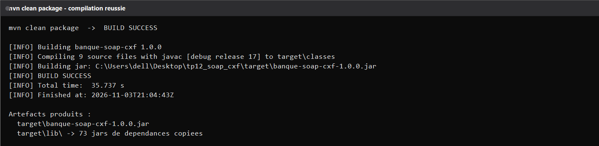

## Le modèle JAXB

Les deux classes de données sont de simples POJO annotés. La classe Compte porte un numéro, un titulaire, une agence, une ville, une devise, un solde et un booléen d'activité. La classe ResultatVirement regroupe la référence du virement, son statut, son message, le montant débité et les deux soldes après l'opération.

Ces classes ne dépendent d'aucune classe CXF. Elles sont seulement annotées avec les annotations JAXB standard, ce qui montre bien que la sérialisation XML est une préoccupation indépendante du transport SOAP.

## Le contrat JAX-WS

L'interface BanqueService décrit le contrat métier avec l'annotation WebService et fixe l'espace de noms du service. Chaque opération est déclarée avec WebMethod, et chaque paramètre est nommé explicitement avec WebParam afin que le WSDL produit reste lisible.

Les quatre opérations du contrat sont la salutation qui prend un nom de client, la consultation d'un compte qui prend un numéro de compte, la liste des comptes d'une agence qui prend le nom de l'agence, et le virement qui prend le compte à débiter, le compte à créditer et le montant.

## L'implémentation métier

L'implémentation BanqueServiceImpl implémente le contrat et contient cinq comptes en mémoire. Les titulaires sont Yassine El Amrani, Salma Benjelloun, Hicham Ouazzani, Nadia Chraibi et Mehdi Berrada. Les agences sont Casablanca Anfa, Rabat Agdal et Marrakech Gueliz.

Les opérations font un vrai travail métier. La consultation renvoie le compte demandé ou un compte vide si le numéro est inconnu. La liste d'agence filtre sur le nom de l'agence. Le virement vérifie que les deux comptes existent et sont actifs, débite le premier, crédite le second et renvoie une référence unique.

## La publication du service avec CXF

Le serveur est publié avec JaxWsServerFactoryBean. Pour chaque endpoint on fixe la classe de service, l'adresse, le nom du service et le nom du port, puis on appelle create pour démarrer le serveur Jetty embarqué.

Le démarrage réel du serveur affiche les trois adresses publiées et rappelle les utilisateurs WS-Security connus.

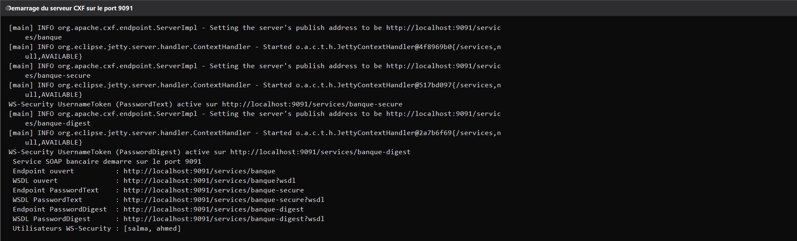

## Le WSDL généré

Le WSDL est disponible par simple requête HTTP sur l'adresse du service suivi de wsdl. Le fichier récupéré montre la cible du service, le style document, le transport HTTP, le portType BanqueService, le binding BanqueServiceSoapBinding et le service BanqueService.

L'analyse détaillée du fichier confirme la structure attendue : un bloc de types, huit messages, un seul portType, un seul binding, un seul service, quatre opérations et dix types complexes générés par JAXB.

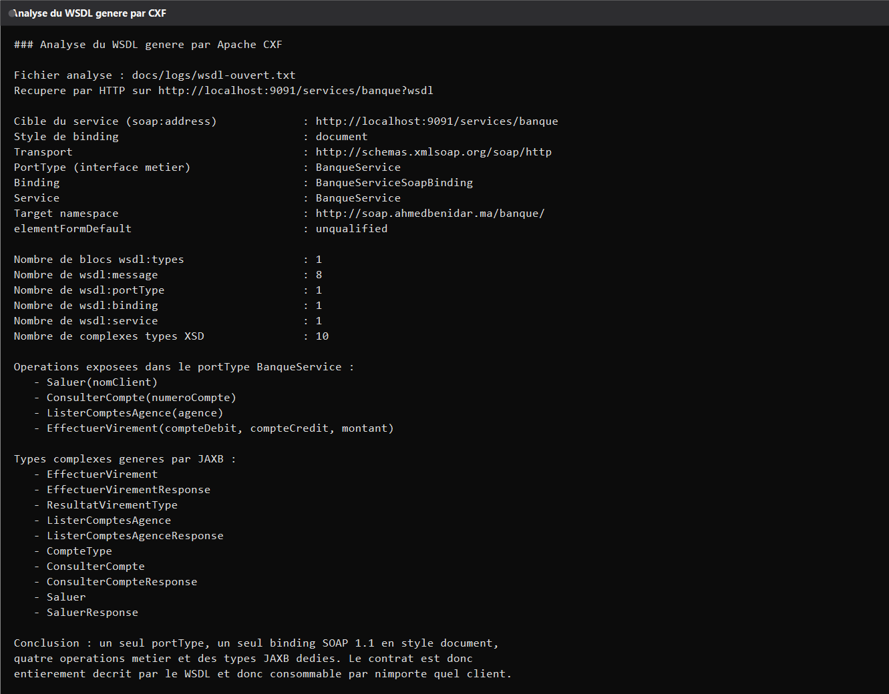

Le WSDL est également consultable directement dans un navigateur, ce qui est la manière la plus simple de vérifier qu'un service est bien exposé.

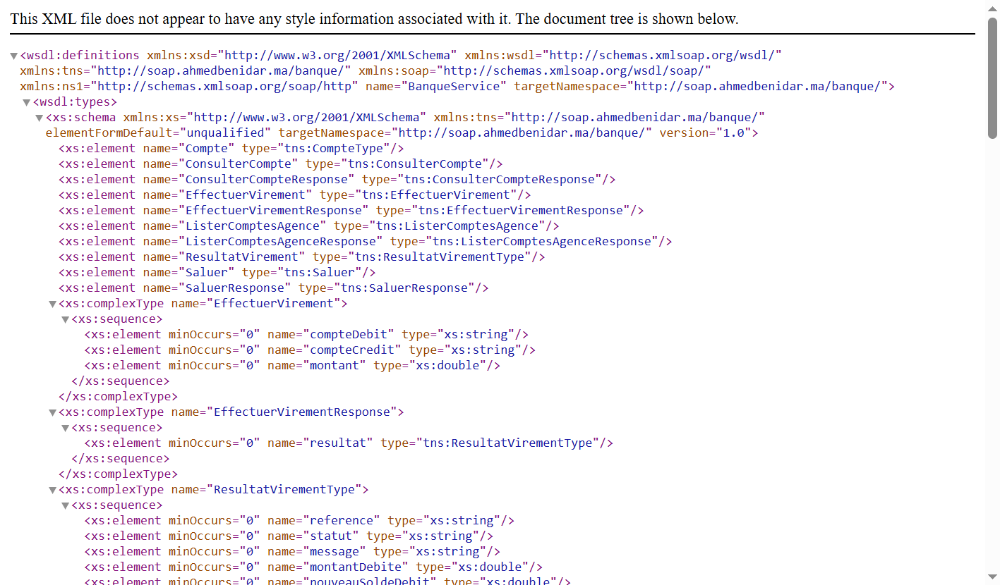

Le même document complet, récupéré par HTTP, est conservé dans les journaux du projet.

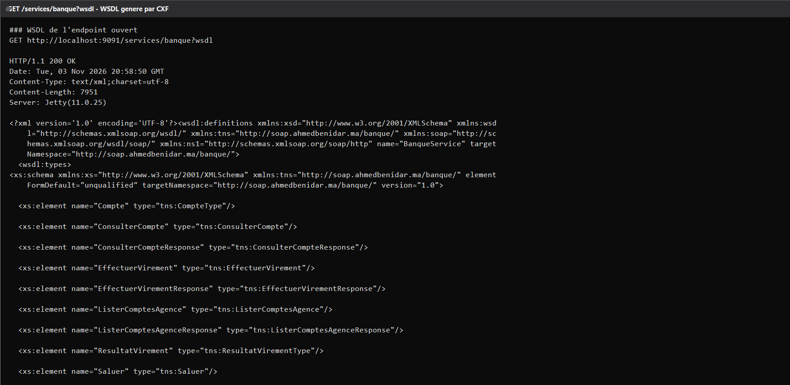

## Les tests réels du service

Le sujet propose SoapUI pour tester le service. SoapUI n'est pas installé sur la machine utilisée, donc les échanges ont été produits autrement mais de manière tout aussi réelle : chaque appel est une requête HTTP POST authentique envoyée au serveur, et le journal conserve la requête envoyée puis la réponse reçue avec ses en-têtes HTTP.

La première opération, la salutation, renvoie le message d'accueil personnalisé.

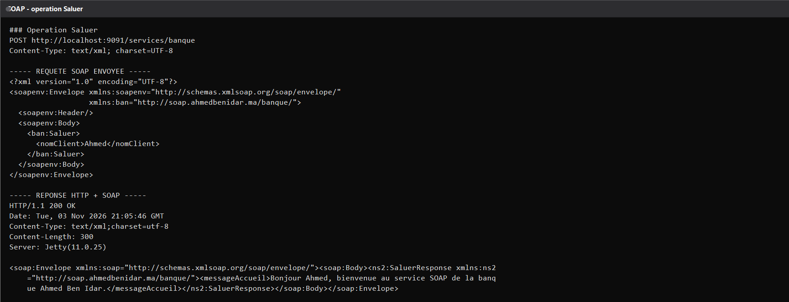

La consultation d'un compte renvoie l'objet Compte sérialisé en XML par JAXB.

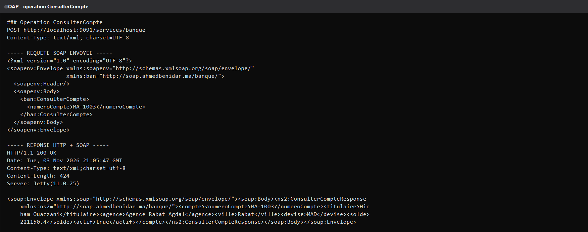

La liste par agence renvoie deux comptes pour Rabat Agdal, ce qui prouve que le filtrage métier fonctionne.

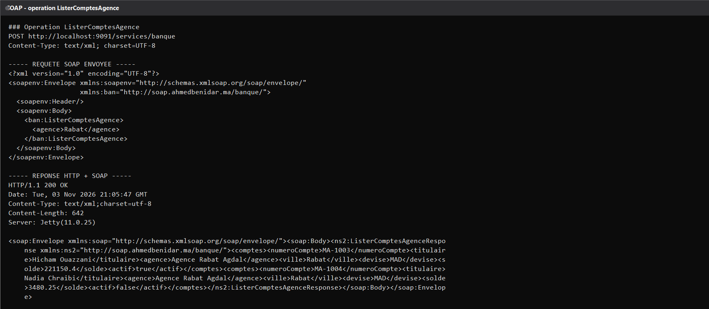

Le virement renvoie le type composé ResultatVirement avec sa référence, son statut et les deux nouveaux soldes.

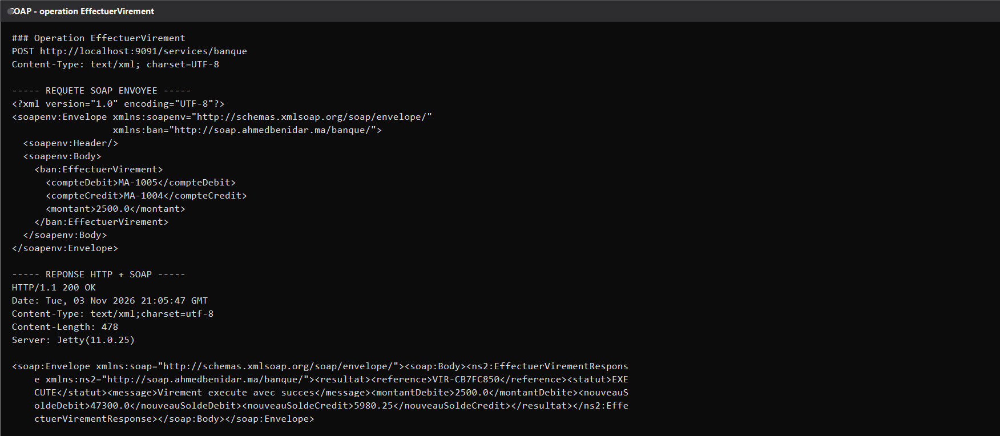

Toutes ces réponses arrivent en HTTP 200 avec un corps SOAP qui contient les données attendues.

## La sécurité WS-Security

Le troisième point du sujet est l'ajout d'une authentification au niveau du message SOAP et non au niveau du transport. Le serveur ajoute un intercepteur WSS4J en entrée avec l'action UsernameToken et un callback qui connaît les utilisateurs autorisés.

Le premier endpoint sécurisé accepte un mot de passe en clair, en PasswordText. Un appel sans jeton est rejeté par le serveur avec une faute SOAP de type SecurityError et un code HTTP 500.

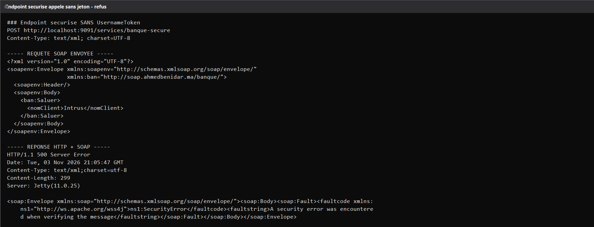

Un appel avec l'utilisateur ahmed et le bon mot de passe passe et renvoie la réponse métier normale.

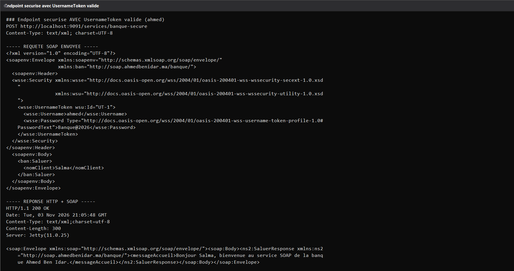

Un appel avec un mauvais mot de passe est rejeté exactement de la même manière qu'un appel sans jeton, ce qui est le comportement attendu pour ne pas renseigner un attaquant.

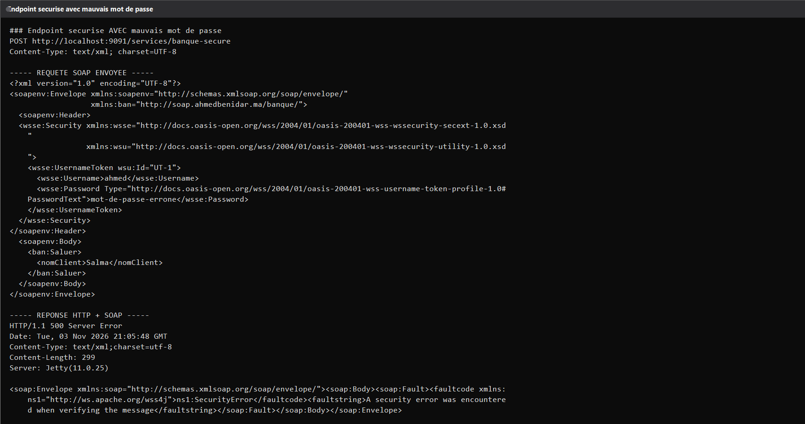

## Le défi : PasswordDigest

Le sujet propose en option de passer en PasswordDigest. Ce choix a été implémenté. Un troisième endpoint a été publié et il attend un jeton dont le mot de passe n'est plus transmis en clair.

Le client calcule une empreinte SHA-1 sur la concaténation du nonce, de l'horodatage de création et du mot de passe, puis encode le résultat en Base64. Le serveur refait le même calcul de son côté avec le mot de passe qu'il connaît et compare les deux empreintes.

Un jeton correctement calculé pour l'utilisatrice salma est accepté et la réponse métier revient normalement.

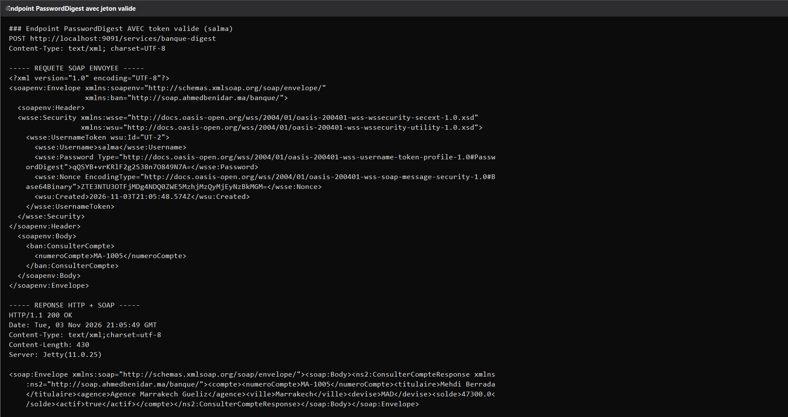

Un jeton calculé avec un mauvais mot de passe est refusé, et le journal du serveur montre que le refus vient bien de la vérification du digest.

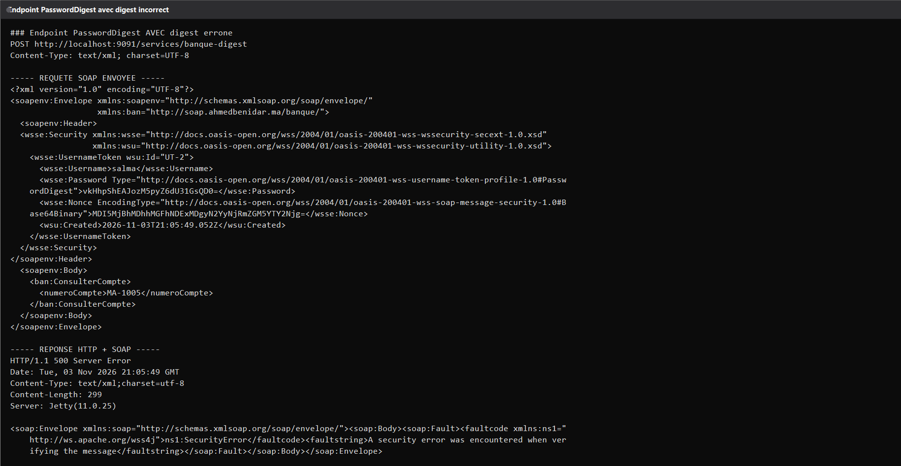

## La trace de validation côté serveur

Le journal du serveur a été filtré pour ne garder que les lignes qui concernent la sécurité. On y voit la publication des trois endpoints, la validation réussie des identifiants, et les deux causes de refus : l'absence de jeton et l'échec de vérification du digest, avec la pile d'appels WSS4J qui va jusqu'à la méthode de vérification du mot de passe.

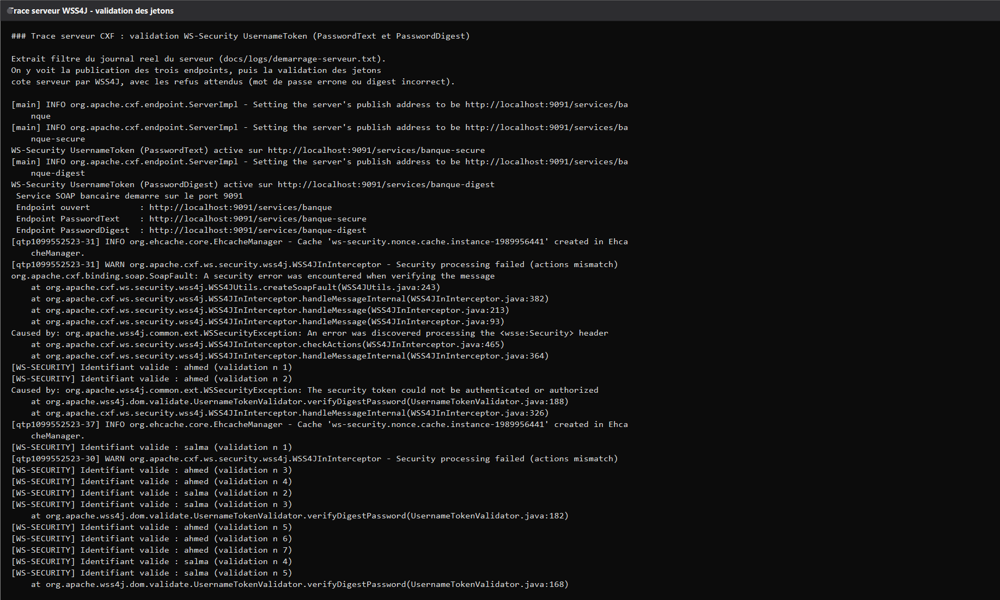

## Le client Java minimal

Le second point du sujet est l'écriture d'un client Java qui consomme le service par l'API standard JAX-WS. Le client construit l'URL du WSDL, crée un objet Service avec le nom qualifié du service, puis récupère un proxy vers le port.

Les quatre opérations sont appelées depuis ce proxy, et les objets renvoyés sont directement des instances Java des classes du modèle.

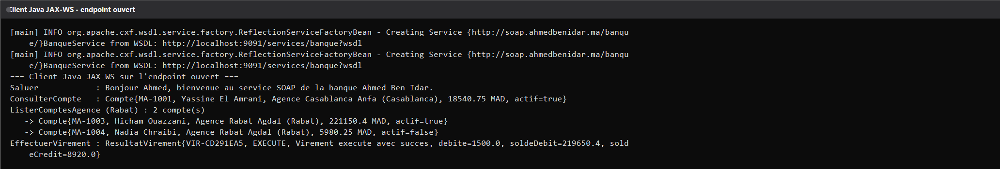

Un second client a été écrit pour les endpoints protégés. Il ajoute un intercepteur WSS4J en sortie pour insérer le jeton dans l'en-tête SOAP. Il joue quatre scénarios : un appel en PasswordText avec les bons identifiants, un appel en PasswordText avec un mauvais mot de passe, un appel en PasswordDigest avec les bons identifiants et un appel en PasswordDigest avec un utilisateur inconnu. Les deux appels incorrects lèvent bien une exception SOAPFaultException côté client.

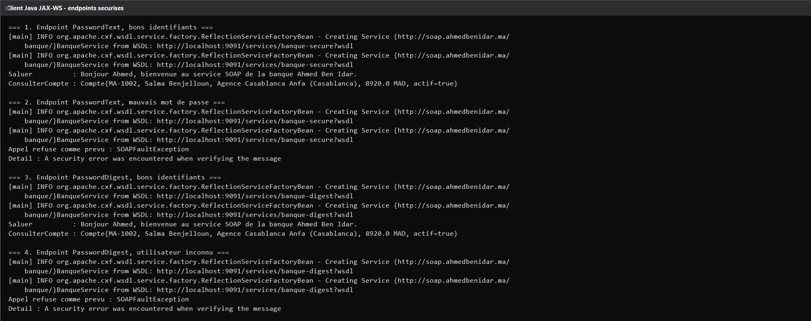

## La place d'UDDI

Le sujet consacre une étape au registre UDDI. UDDI était l'annuaire historique de la SOA, où l'on publiait un service puis où les clients venaient le trouver avant de s'y lier. Il n'est plus utilisé dans les architectures actuelles, où la découverte se fait plutôt par la plateforme, par un annuaire de services interne ou simplement par une URL de WSDL connue. Le WSDL reste en revanche central, puisque c'est lui qui porte tout le contrat.

## Les points à retenir

Le WSDL généré par CXF déclare elementFormDefault à unqualified. Concrètement, les éléments internes du corps SOAP doivent être envoyés sans préfixe d'espace de noms alors que l'élément qui enveloppe l'opération doit être qualifié. Envoyer un préfixe partout provoque une erreur de démarshalling.

Il ne faut pas envoyer d'en-tête SOAPAction vide. Un en-tête présent mais vide fait échouer l'intercepteur de CXF avec une exception d'index hors limites, ce qui produit une erreur 500 difficile à interpréter. Il vaut mieux omettre complètement l'en-tête.

Le PasswordDigest n'est pas un chiffrement mais une preuve de connaissance du mot de passe, et il ne protège pas contre le rejeu si l'horodatage n'est pas contrôlé. C'est pour cela que le sujet recommande aussi HTTPS et la signature des messages pour des échanges sensibles.

## Lancer le projet

Le projet se compile avec Maven et se lance avec Java. La classe principale du serveur est ServeurBanque, celle du client ouvert est ClientJava et celle du client sécurisé est ClientSecurise.

Une fois le serveur lancé, les trois WSDL sont accessibles respectivement sur les chemins banque, banque-secure et banque-digest sous l'adresse du serveur. Le script de capture placé dans docs/tools rejoue l'ensemble des appels et réécrit les journaux du dossier docs/logs, ce qui permet de régénérer toutes les images de ce document.

## Conclusion

Ce TP montre qu'un service SOAP tient en très peu de code métier, parce que l'essentiel du travail est pris en charge par la pile CXF : publication, génération du contrat, sérialisation et sécurité sont des intercepteurs et des annotations. La contrepartie est une configuration précise, où un préfixe d'espace de noms ou un en-tête mal formé suffit à faire échouer un appel. Les captures de ce document viennent toutes d'un service réellement lancé sur le port 9091.
